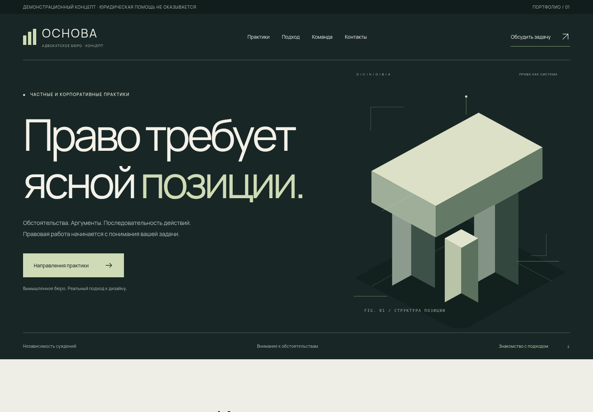
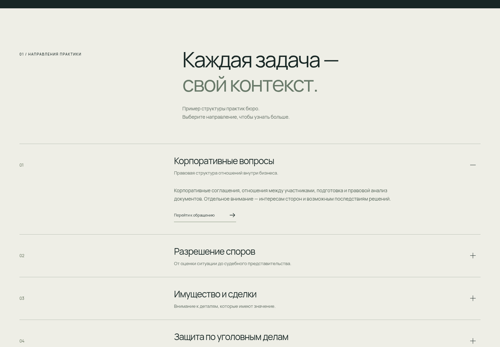
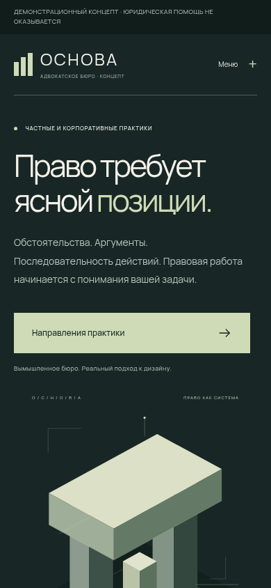

# Основа

Презентационный сайт вымышленного адвокатского бюро. Тёмная корпоративная эстетика, крупная типографика и авторская архитектурная графика объединяют практики, подход и порядок взаимодействия.

## Для каких практик

Для адвокатских бюро и объединений с корпоративной, судебной, имущественной практикой или защитой по уголовным делам. Подойдёт для представления нескольких направлений и распределения ответственности внутри команды.

## Возможности

- Адаптивный editorial-дизайн и авторская графика
- Якорная и мобильная навигация, FAQ и доступный диалог
- Четыре раскрывающиеся практики и схема командных ролей
- Демоформа без сбора и отправки персональных данных
- Локальные шрифты, SEO-метаданные и reduced motion
- Браузерные тесты на четырёх ширинах, axe и Lighthouse

## Стек

React · Vite · TypeScript · CSS · Playwright · axe-core · Netlify-ready.

## Ссылки

Публичный HTTPS: **пока отсутствует — требуется вход владельца в Netlify**. Ссылка на репозиторий не является ссылкой на опубликованный сайт.

Исходники: локальный репозиторий `legal-bureau-demo` и переносимый архив. Удалённый GitHub-репозиторий ещё не создан из-за ограничений прав интеграции.

## Скриншоты

Сняты с production build в Chromium. Подходят для портфолио как демонстрационные материалы.

## Персонализация

Название и специализация → согласованный контент → реальные сведения об адвокате/образовании → контактная информация → фотографии с правами → юридические документы и отдельно спроектированная рабочая форма. Контент адаптируется без изменения основной композиционной идеи. Подробности в README.

Это коммерческий портфолио-концепт веб-студии, а не работа для существующего клиента. Представленные роли и персонажи вымышлены.
